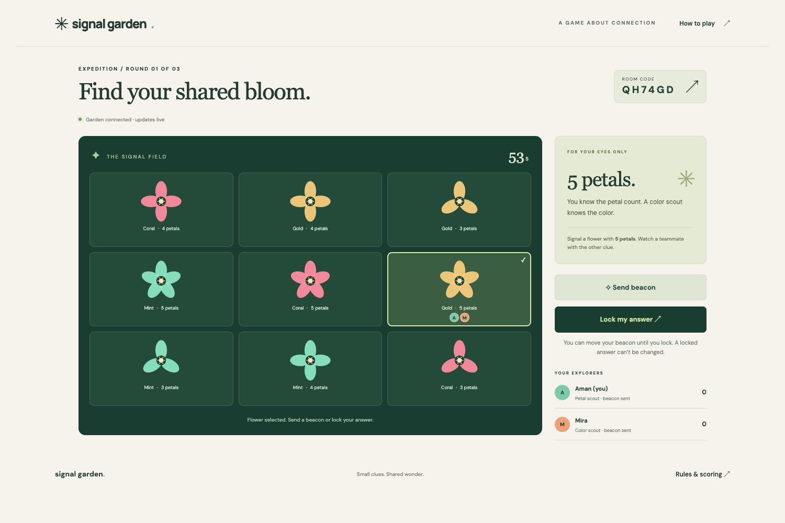

# Signal Garden

**[Play the live game](https://signal-garden-aman.amankumars221.chatgpt.site)** · 2–8 players · No account required



A multiplayer deduction game for 2–8 friends. Each player knows one attribute of a shared hidden flower. They communicate through beacons, combine color and petal clues, and lock a choice before the 60-second round ends. Three rounds grow the field from 9 to 12 to 16 flowers.

## Rules

- Join the same six-character room from separate devices. No account or microphone required.
- A color scout signals the target color; a petal scout signals its petal count. Roles alternate each round.
- Select a flower, send a publicly visible beacon, and adjust it as new information arrives.
- Lock an answer once confident. Locked choices remain private until everyone locks or the timer ends.
- Correct answer: 100 points. Everyone correct: 50 extra points each. Correct answer and final beacon on target: 25 extra points.
- Unanswered or incorrect choices earn zero. Highest total after three rounds wins; ties share the crown.
- Any participant can advance from results or initiate a rematch. Refreshing the same tab restores the player's seat.

## Run locally

Requires Node.js 22.13 or newer and Git.

```sh
git clone https://github.com/Amanky09/signal-garden.git
cd signal-garden
npm run install:ci
npm run build
node --import ./scripts/sites-env.mjs ./node_modules/wrangler/bin/wrangler.js d1 execute DB --local --config dist/server/wrangler.json --persist-to .wrangler/state --file drizzle/0000_sleepy_luckman.sql
npm run dev
```

Open the local URL printed by the dev server. Use a normal window and an incognito window to test as two separate players. The local database is separate from the live game.

For a production-build preview, run `npm start` after building and applying the migration.

Game logic: `lib/game.ts`. D1-backed HTTP API: `app/api/game/route.ts`. Client UI: `app/page.tsx` and `app/globals.css`.

## Technical design

The server owns targets, timers, scoring and room transitions. Each player receives only their own partial clue; other choices and session tokens never appear in another player's response. Room updates use version-checked database writes and retry conflicts. Clients poll every 1.2 seconds, recover their tab session after refresh, and ignore older state versions. Timers are adjusted against the server clock. A timeout is resolved by the next room request, so progress does not depend on one host device.

Rooms are playable for twelve hours. The browser stores the room credential in sessionStorage and a display-name preference in localStorage. Closing the tab can lose the seat. Players cannot join mid-expedition, but can join again when the group returns to the lobby. A dropped participant receives zero for unanswered rounds; remaining players can continue after the timer expires.

## Verification

- `node --experimental-strip-types --test tests/game.test.ts`
- `npx tsc --noEmit`
- `npm run build`
- Independent desktop/mobile browser contexts: tutorial, room creation, invited join, beacon synchronization, three full rounds, expected scoring, refresh recovery and rematch.
- Eight simultaneous players: joining, capacity enforcement, invalid credentials, late joining, signals, choices and single scoring transition.

The game art is original procedural SVG and CSS. Fonts are DM Sans and Manrope, with local fallbacks.

## Hosting

The live game is hosted on ChatGPT Sites with a Cloudflare Worker and D1 database. This GitHub repository publishes the source. GitHub Pages alone cannot run the multiplayer API or shared database.

The hosting manifest declares the D1 binding but omits the original Site identity, so a new deployment must provision its own Site and database. Local development does not require the original owner’s credentials.

## Test evidence

See [QA notes](QA-NOTES.md) and [public-deployment verification](docs/verification.md). The screenshot shows controlled QA browser sessions.
